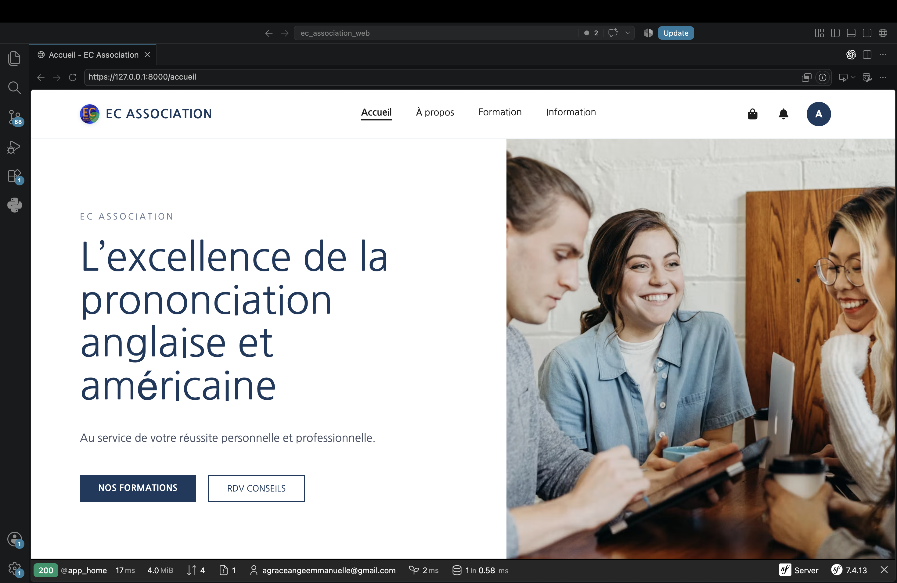
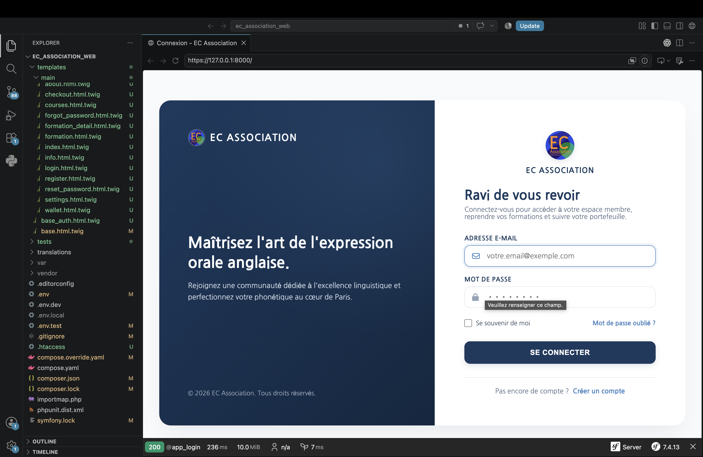
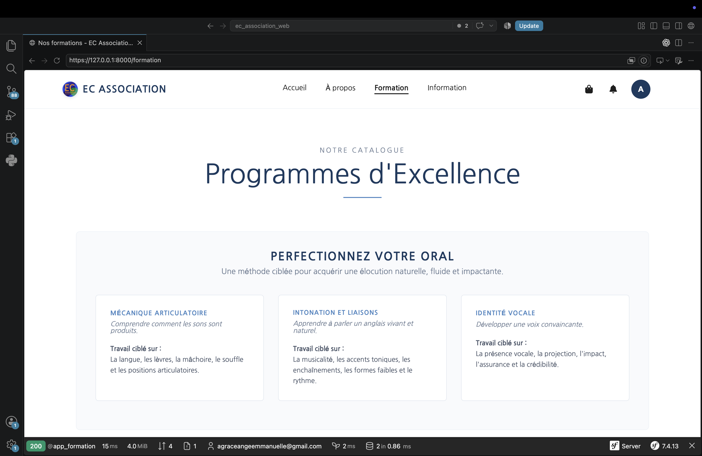
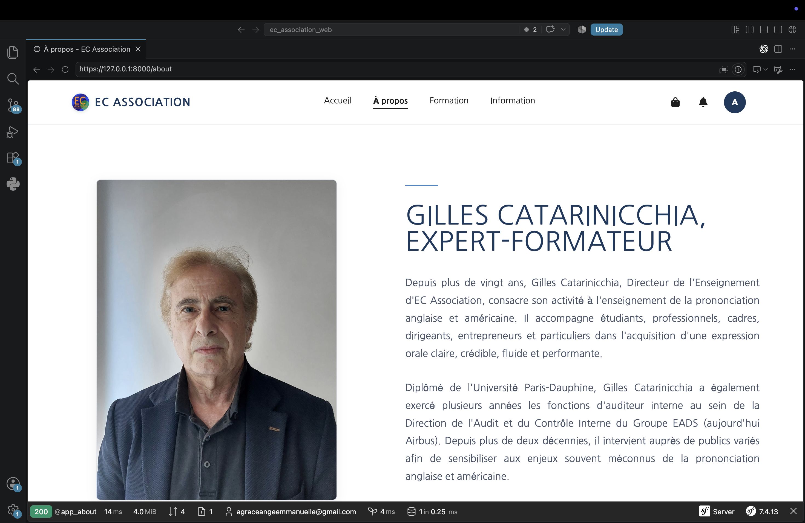
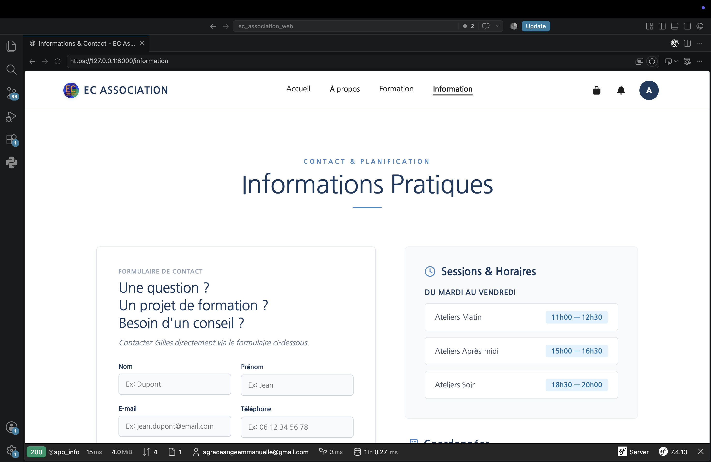
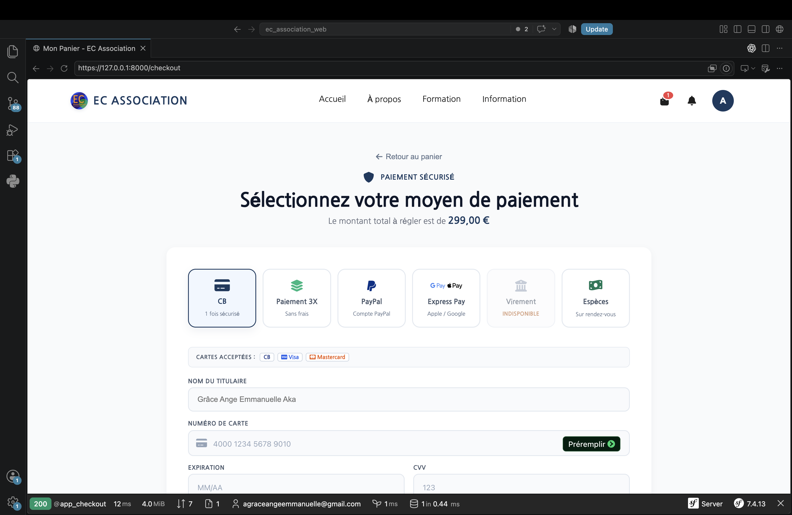
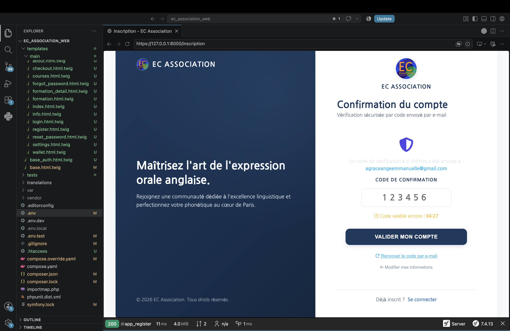

# 🇬🇧 EC-Association — Plateforme de formation en anglais

## 📌 À propos du projet

Ce projet est un site web conçu et développé dans le cadre de mon stage chez **EC-Association**.

L'objectif du site est de permettre aux utilisateurs de découvrir et d'acheter des formations en anglais.

J'ai participé à la réalisation complète du site, de la conception au développement. Le projet n'a pas été déployé avant la fin de ma période de stage.

---

## 🎯 Fonctionnalités

Le site permet notamment de :

* 📚 Découvrir les formations disponibles
* 🔎 Consulter les informations sur les différentes formations
* 🛒 Sélectionner et acheter une formation
* 📧 Recevoir des emails grâce au système de messagerie
* 💳 Tester le processus de paiement en environnement de test

> **Note :** Les véritables API de paiement n'ont pas été intégrées en production avant la fin du stage. Le système de paiement est resté en phase de test.

---

## 🛠️ Technologies utilisées

* **Symfony**
* **PHP**
* **MySQL**
* **Symfony Mailer**
* **Composer**

---

## 👩🏽‍💻 Mon rôle

Dans le cadre de mon stage, j'ai participé à la réalisation de l'ensemble du site, notamment :

* Conception et développement du site web
* Développement des différentes pages et fonctionnalités
* Mise en place du back-end avec Symfony et PHP
* Gestion et utilisation de la base de données MySQL
* Mise en place de l'envoi d'emails
* Intégration et tests du processus de paiement
* Tests et corrections avant la fin de la mission

---

## 📸 Aperçu du site

Il faut noté que ce sont les images principales du site

### 🏠 Page d'accueil

### 🔐 Connexion

### 📚 Formations

### 📖 À propos

### ℹ️ Informations sur une formation

### 💳 Paiement

### ✅ Confirmation du code OTP lors de l'inscription

---

## 🚀 Statut du projet

Le développement du site a été réalisé dans le cadre de mon stage chez **EC-Association**.

À la fin de ma période de stage :

* Le site était développé et fonctionnel en environnement de développement
* Le système de paiement était en phase de test
* Les véritables API de paiement n'étaient pas encore intégrées
* Le déploiement et la mise en ligne n'ont pas été réalisés avant la fin de ma mission

---

### 📌 Projet réalisé dans le cadre d'une expérience professionnelle de stage.
